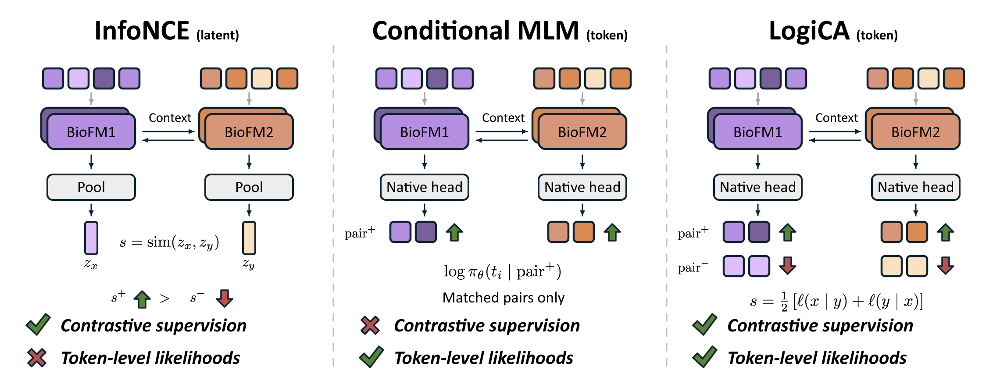
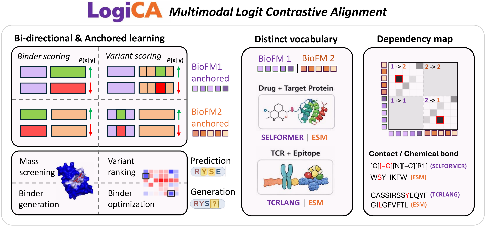
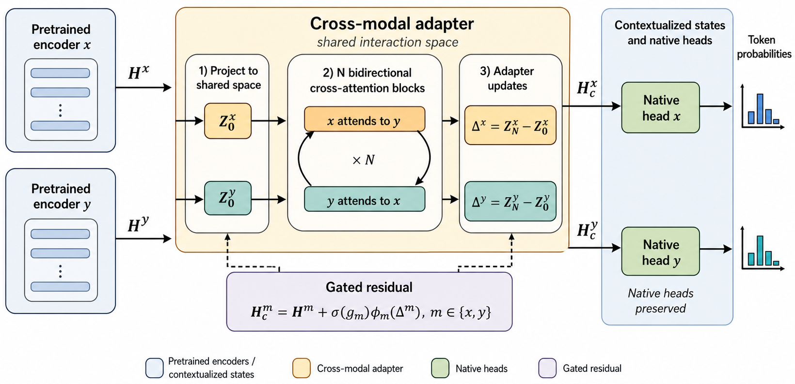
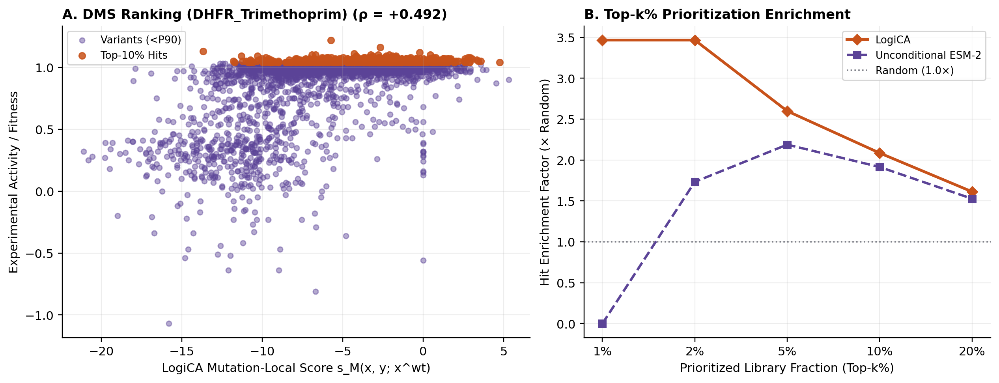
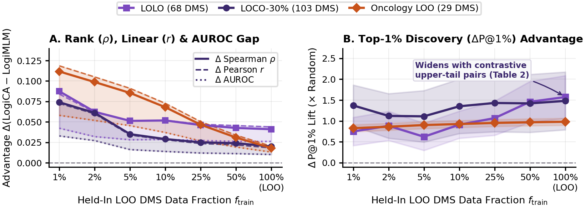
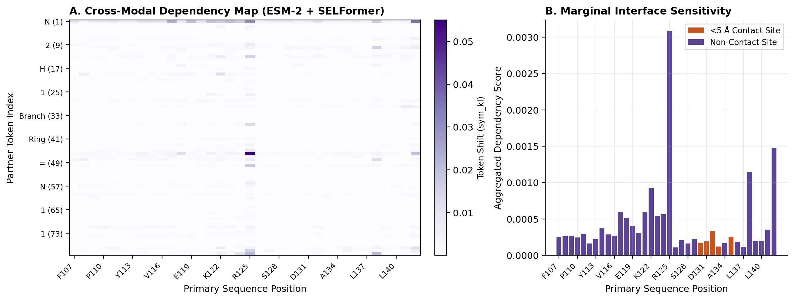
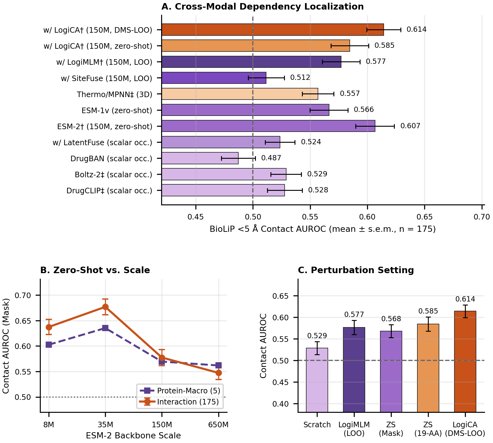
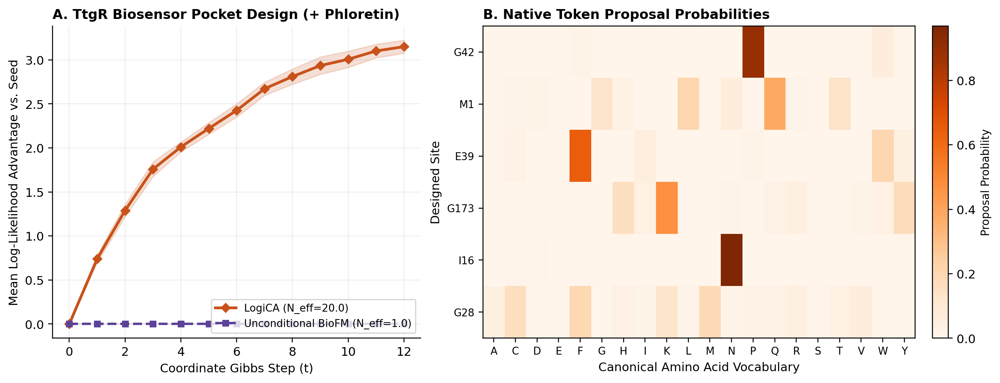
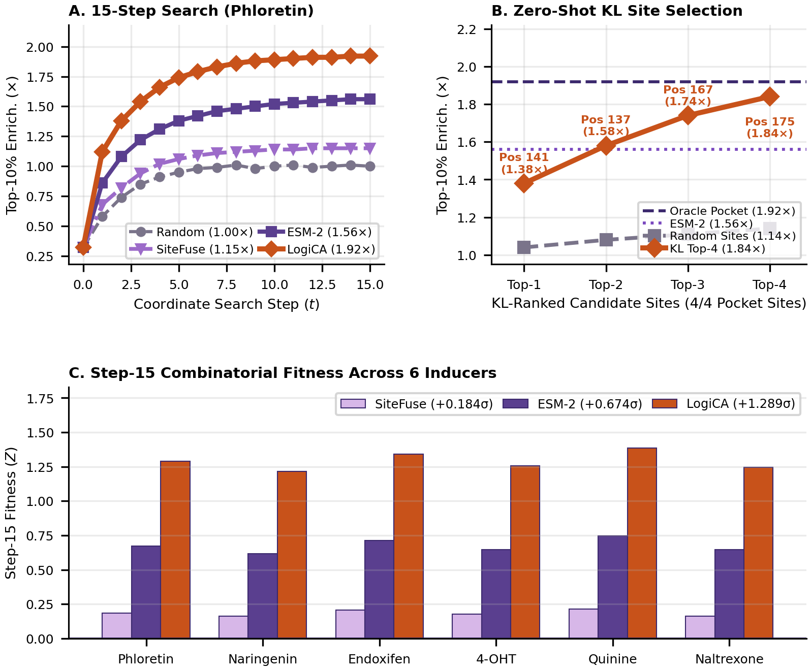
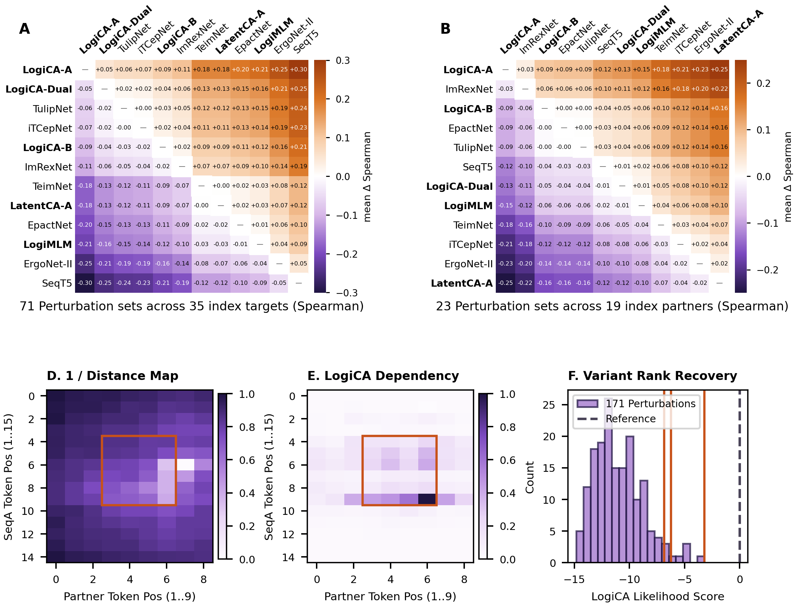

# LogiCA: Contextualizing Biological Language Models via Logit-Space Contrastive Alignment

[](https://arxiv.org/abs/2606.18703)
[](manuscript/LogiCA_manuscript.pdf)
[](LICENSE)
[](pyproject.toml)
[](https://www.kaggle.com/datasets/aurlienplissier/protein-ligand-dms)
[](https://www.kaggle.com/datasets/aurlienplissier/tcr-peptide-dms)
[](https://www.kaggle.com/datasets/aurlienplissier/abrank)
[](https://huggingface.co/Yale-CompBio/logica)
[](https://huggingface.co/ydchen/logica-tcr)

<p align="center">
  
</p>

<p align="center">
  
</p>

Pretrained Biological Foundation Models (**BioFMs**) — spanning proteins (`ESM-2`, `ProtBERT`), small molecules (`SELFormer`, `ChemBERTa`), immune repertoires (`TCRLang`, `AbLang2`), and nucleic acids (`Nucleotide Transformer`) — encode rich evolutionary, structural, and chemical priors through **normalized probability distributions over their native token vocabularies**. Yet standard multimodal adaptation either:
1. **Discards the native token head** in favor of pooled latent embeddings or scalar MLP classifiers (`CLIP` / `DrugCLIP` / `MolTrans`), losing residue-level mutation localization, interpretability, and sequence generation; or
2. **Trains positive-only conditional Masked Language Modeling (`MLM`)**, which reconstructs tokens on matched pairs without separating true biological contexts from plausible decoys.

**LogiCA** (*Logit-Space Contrastive Alignment*) resolves this trade-off by changing the **object of alignment**: instead of aligning pooled hidden vectors, LogiCA couples arbitrary BioFMs via lightweight **native-head-preserving Gated Cross-Attention adapters** and applies contrastive / preference supervision **directly to the context-conditioned native token likelihoods**.

Because each BioFM's original vocabulary head is strictly preserved, **one unified model** exposes three emergent, head-free capabilities out-of-the-box:
- **Mutation-Local Variant Ranking** ($s_{\mathcal{M}}(x, y; x^{\mathrm{wt}})$) with exact wild-type conservation cancellation;
- **Zero-Shot Cross-Modal & Epistatic Dependency Maps** ($D_{ij}^{y \to x}$) localizing `<5 Å` binding interfaces without 3D structural labels;
- **Decoder-Free Context-Conditioned Coordinate Gibbs Sampling** ($x_i^{(t+1)} \sim \pi_\theta(\cdot \mid x_{\setminus i}^{(t)}, y)$) for targeted sequence design.

---

## Architecture: A Model-Agnostic BioFM Toolbox

<p align="center">
  
</p>

The **`logica`** Python package is designed from the ground up as a **flexible, model-agnostic toolbox**:
- **Any Pair of Pretrained BioFMs (`Dual-BioFM`)**: Pass *any* two Hugging Face Masked LM links (e.g. `"facebook/esm2_t30_150M_UR50D"` + `"HUBioDataLab/SELFormer"`, `"InstaDeepAI/nucleotide-transformer-..."`), repertoire BioFMs (`"tcrlang-paired"`, `"ablang2-paired"`), or custom PyTorch `nn.Module` encoders — even when their vocabularies, tokenizers, sequence lengths, and hidden dimensions are completely different.
- **Single-BioFM Logit-Space Fine-Tuning (`partner=None`)**: Pass a *single* BioFM (`LogiCA.from_pretrained("facebook/esm2_t30_150M_UR50D")`) to fine-tune its native token distribution with late-layer LoRA, gated self-adapters, Bradley–Terry / Plackett–Luce ranking losses, and ancestral KL trust-region anchoring ($D_{\mathrm{KL}}(\pi_\theta \parallel \pi_0)$).
- **Drop-In Pretrained Checkpoint Loading**: Automatically resolves and loads official pretrained checkpoints from Hugging Face Hub (`Yale-CompBio/logica` across `8m`, `35m`, `150m`, `650m` and `ydchen/logica-tcr` across all 5 anchor configurations) or local `.pt` / `.safetensors` files.

---

## Repository Structure & Domain Applications

```text
LogiCA/
├── logica/                              # Core model-agnostic Python library (`pip install -e .`)
│   ├── backbones.py                     # Universal BioFM loader (HuggingFace, AbLang2/TCRLang, Custom nn.Module)
│   ├── adapters.py                      # Gated Cross-Attention, Sigmoid/Top-K attn, Unimodal Self-Adapter & LoRA
│   ├── model.py                         # Unified `LogiCA` class (Dual-BioFM, Single-BioFM & HF checkpoint loading)
│   ├── losses.py                        # InfoNCELogitLoss, BradleyTerry, PlackettLuce, KL Anchor & Thermo Scorer
│   ├── ranking.py                       # `VariantRanker` (WT-marginal, stride-masked, simultaneous multi-mask, LOO)
│   ├── dependency.py                    # `DependencyMapper` (2D cross-modal & intra-seq maps + KL hotspot detector)
│   ├── gibbs.py                         # `GibbsSampler` (Coordinate Gibbs MCMC design & DMS landscape protocols)
│   └── visualization.py                 # Publication-ready Matplotlib plots for ranking, dependency maps & Gibbs
├── applications/                        # End-to-end domain suites built on `logica`
│   ├── protein-ligand/                  # Protein–Ligand Interactions (ESM-2 + SELFormer)
│   ├── tcrlang-esm/                     # TCR–pMHC Interactions (TCRLang + ESM-2)
│   └── antibodies-abrank/               # Antigen–Antibody Interactions (AbLang2 + ESM-2, AbRank & SAbDab)
├── examples/
│   └── quickstart_showcase.py           # End-to-end live demo generating all example visualizations
└── tests/
    └── test_logica_toolbox.py           # Unit test suite covering Dual-BioFM, Single-BioFM, losses & readouts
```

| Domain Application | Coupled BioFMs | Hugging Face Weights | Kaggle Dataset | Datasets & Scripts Included |
| :--- | :--- | :--- | :--- | :--- |
| **Protein–Ligand Interactions**<br>[`applications/protein-ligand/`](applications/protein-ligand/) | `ESM-2` (`8M`–`650M`) $\leftrightarrow$ `SELFormer` | [**`Yale-CompBio/logica`**](https://huggingface.co/Yale-CompBio/logica) (`8M`–`650M`) | [**`kaggle/protein-ligand-dms`**](https://www.kaggle.com/datasets/aurlienplissier/protein-ligand-dms) | BindingDB pretraining, DMS kinetics & drug binding, BioLiP interaction maps, Gibbs pocket design |
| **TCR–pMHC Interactions**<br>[`applications/tcrlang-esm/`](applications/tcrlang-esm/) | `TCRLang-Paired` (`CDR3β\|CDR3α`) $\leftrightarrow$ `ESM-2` | [**`ydchen/logica-tcr`**](https://huggingface.co/ydchen/logica-tcr) (5 anchor configs) | [**`kaggle/tcr-peptide-dms`**](https://www.kaggle.com/datasets/aurlienplissier/tcr-peptide-dms) | TCR–pMHC binding data, peptide-anchored DMS, TCR-anchored DMS, TCR3d interaction maps & CDR3 Gibbs design |
| **Antigen–Antibody Interactions**<br>[`applications/antibodies-abrank/`](applications/antibodies-abrank/) | `AbLang2-Paired` (`VH\|VL`, `VHH\|`) $\leftrightarrow$ `ESM-2` | Base: [`Yale-CompBio/ablang2-hf`](https://huggingface.co/Yale-CompBio/ablang2-hf) + `ESM-2`<br>*(train via script 02)* | [**`kaggle/abrank`**](https://www.kaggle.com/datasets/aurlienplissier/abrank) | AbRank benchmark, SAbDab `<5 Å` dependency maps & AbLang–ESM Gibbs evaluation |

> **Processed Datasets on Kaggle:** To keep this code repository lightweight, all processed benchmark tables, pretraining splits, and structural contact/dependency-map tables are hosted ready-to-download on Kaggle ([`protein-ligand-dms`](https://www.kaggle.com/datasets/aurlienplissier/protein-ligand-dms), [`tcr-peptide-dms`](https://www.kaggle.com/datasets/aurlienplissier/tcr-peptide-dms), and [`abrank`](https://www.kaggle.com/datasets/aurlienplissier/abrank)) and auto-fetched via `kagglehub` by every application script.

---

## Installation

Python 3.10 or later is recommended. Clone the repository and install `logica` in editable mode:

```bash
git clone https://github.com/AI-SysBio/LogiCA.git
cd LogiCA

# Core library (Hugging Face BioFMs, Gated Cross-Attention, Ranking, Dependency Maps, Gibbs)
pip install -e .

# Install with chemistry (RDKit + SELFIES) and TCR/Antibody (AbLang2) extras + pytest
pip install -e ".[all]"

# Run the unit test suite
pytest
```

---

## Quickstart: Using the Model-Agnostic `logica` Library

### 1. Instantiate Any Pair of BioFMs — or a Single BioFM — or Load Pretrained Weights

```python
from logica import LogiCA

# Option A: Couple ANY two Hugging Face BioFMs (distinct vocabularies & hidden sizes!)
dual_model = LogiCA.from_pretrained(
    primary="facebook/esm2_t30_150M_UR50D",   # Protein LM (V=33, D=640)
    partner="HUBioDataLab/SELFormer",         # Chemical SELFIES LM (V=800, D=768)
    width=384,                                # Shared cross-attention bottleneck d_s
    layers=2,
    gate_mode="tanh_zero",                    # Exact identity at step 0, unit gradient!
)

# Option B: Single-BioFM native-logit fine-tuning (partner=None)
single_model = LogiCA.from_pretrained(
    primary="facebook/esm2_t12_35M_UR50D",
    partner=None,                             # Unimodal gated self-adapter + late-layer LoRA
)

# Option C: Load official pretrained checkpoints directly from Hugging Face Hub
pl_model = LogiCA.from_checkpoint("Yale-CompBio/logica", scale="150m", device="cpu")
tcr_model = LogiCA.from_checkpoint("ydchen/logica-tcr", subfolder="dual-anchored-ratio5", device="cpu")
```

### 2. Fine-Tune with Contrastive / Preference Losses in Native Logit Space

```python
import torch
from logica import AncestralKLAnchorLoss, InfoNCELogitLoss, PlackettLuceLogitLoss, VariantRanker

# Freeze early layers, inject LoRA into top-4 primary & top-2 partner blocks, 5x LR on gates/adapter
param_groups = dual_model.configure_finetuning_optimizer(
    base_lora_lr=1e-4,
    adapter_lr_multiplier=5.0,
    top_k_primary_lora=4,
    top_k_partner_lora=2,
    lora_rank=8,
)
optimizer = torch.optim.AdamW(param_groups)

# Stage 1 (Cross-Modal Pair Alignment): Bidirectional Masked-Gain InfoNCE
infonce = InfoNCELogitLoss(temperature=0.07, alpha=0.5, mask_fraction=0.15)
p_batch = dual_model.primary_backbone.tokenize(["MKTIIALSYIFCLVFA...", "IPVAIKELREATSPKA..."])
d_batch = dual_model.partner_backbone.tokenize(["COc1cc2ncnc...", "CC(=O)Oc1ccccc1C(=O)O"])
loss_dict = infonce(dual_model, p_batch, d_batch)
loss_dict["loss"].backward()
optimizer.step()

# Stage 2 (DMS Variant Preference Alignment — works for BOTH Dual-BioFM and Single-BioFM!)
ranker = VariantRanker(dual_model)
pl_loss = PlackettLuceLogitLoss(top_m=32)
kl_anchor = AncestralKLAnchorLoss()
```

---

## Core Capabilities & Visual Examples

Run [`examples/quickstart_showcase.py`](examples/quickstart_showcase.py) to execute all three native-logit readouts live on pretrained checkpoints and generate the plots below:

```bash
python examples/quickstart_showcase.py
```

### 1. Mutation-Local Variant Ranking ($s_{\mathcal{M}}(x, y; x^{\mathrm{wt}})$)

Given a wild-type sequence $x^{\mathrm{wt}}$, candidate variants, and an external biological context $y$ (or `context=None` for a single BioFM), `LogiCA` evaluates the site-averaged log-likelihood ratio strictly over the mutated positions $\mathcal{M}(x, x^{\mathrm{wt}}) = \{i : x_i \neq x_i^{\mathrm{wt}}\}$ — requiring **zero structural or pocket annotations**:

```python
ranking = pl_model.rank_variants(
    wild_type=ttgr_wt_sequence,
    variants=["H67A", "L66W_V96I", "I141W", "E78K_I141Y"],
    context="O=C(CCc1ccc(O)cc1)c1c(O)cc(O)cc1O",  # Phloretin (SMILES or SELFIES)
    variants_are_mutation_strings=True,
    mode="stride_masked",                          # Options: wt_marginal, stride_masked, masked_sites, exact_loo
    component="guided",                            # Options: holo, ddg_shift, apo, guided
)
for idx, label, score in ranking.top_k(3):
    print(f"{label:15s}  score = {score:+.4f}")
```

<p align="center">
  
</p>

<p align="center">
  
</p>

---

### 2. Zero-Shot Cross-Modal Dependency Maps ($D_{ij}^{y \to x}$) & KL Hotspot Self-Detection

Without any 3D structural or contact-label supervision during training, perturbing each partner token $y_j$ and measuring the induced shift in native amino-acid probabilities at $x_i$ localizes `<5 Å` heavy-atom contacts across both protein–ligand (`BioLiP-175`) and TCR–pMHC (`TCR3d-251`) crystal complexes:

```python
from logica import plot_dependency_map

# Compute 2D residue x ligand-token dependency map (or intra-sequence epistatic map if partner=None)
dep = pl_model.dependency_map(protein_seq, ligand_smiles, metric="sym_kl")
print("Top 5 ligand-coupled protein residues:", dep.top_primary_sites(5))

# Single-pass zero-shot pocket discovery when interface sites A are 100% unknown:
hotspots = pl_model.detect_kl_hotspots(protein_seq, ligand_smiles, top_k=6)
print("KL-detected pocket positions (1-based):", hotspots["top_positions_1based"])

plot_dependency_map(dep, contact_residues_1based=[137, 141, 167, 175], save_path="dependency_map.png")
```

<p align="center">
  
</p>

<p align="center">
  
</p>

---

### 3. Decoder-Free Context-Conditioned Coordinate Gibbs Design

Because `LogiCA` preserves normalized categorical distributions over the native 20-amino-acid vocabulary at every site, it supports multi-step **Coordinate Pseudo-Gibbs and Metropolis-within-Gibbs sequence design** directly over known or KL-discovered pocket/CDR3 positions — without training an autoregressive decoder:

```python
from logica import plot_gibbs_design

# Automatically detects the top-6 ligand-sensitive KL hotspots and runs 20 parallel Gibbs chains
gibbs_holo = pl_model.gibbs_sample(
    seed_sequence=ttgr_wt_sequence,
    context="O=C(CCc1ccc(O)cc1)c1c(O)cc(O)cc1O",   # Phloretin inducer
    auto_kl_top_k=6,                               # Zero 3D pocket annotation needed!
    num_chains=20,
    num_steps=12,
    temperature=0.3,
    guided_beta=0.6,
)
for seq, score in gibbs_holo.top_designs(k=3):
    print(f"Designed score = {score:+.3f} | N_eff = {gibbs_holo.effective_sample_size:.1f}")

plot_gibbs_design(gibbs_holo, save_path="gibbs_design.png")
```

<p align="center">
  
</p>

<p align="center">
  
</p>

---

### 4. TCR–Peptide Recognition, Dependency Maps & Pairwise Benchmarks (`applications/tcrlang-esm/`)

<p align="center">
  
</p>

See [**`applications/protein-ligand/README.md`**](applications/protein-ligand/README.md), [**`applications/tcrlang-esm/README.md`**](applications/tcrlang-esm/README.md), and [**`applications/antibodies-abrank/README.md`**](applications/antibodies-abrank/README.md) (paired with [**`AI-SysBio/AbRank`**](https://github.com/AI-SysBio/AbRank)) for complete data download, preprocessing, pretraining, fine-tuning, and benchmark reproduction commands.

---

## Citation

If you use **LogiCA** or the benchmarks in this repository, please cite:

```bibtex
@inproceedings{logica2027,
  title     = {Contextualizing Biological Language Models across Modalities via Logit-Space Contrastive Alignment},
  booktitle = {International Conference on Learning Representations (ICLR)},
  year      = {2027},
  url       = {https://arxiv.org/abs/2606.18703}
}
```

## License

This project is released under the [MIT License](LICENSE).
